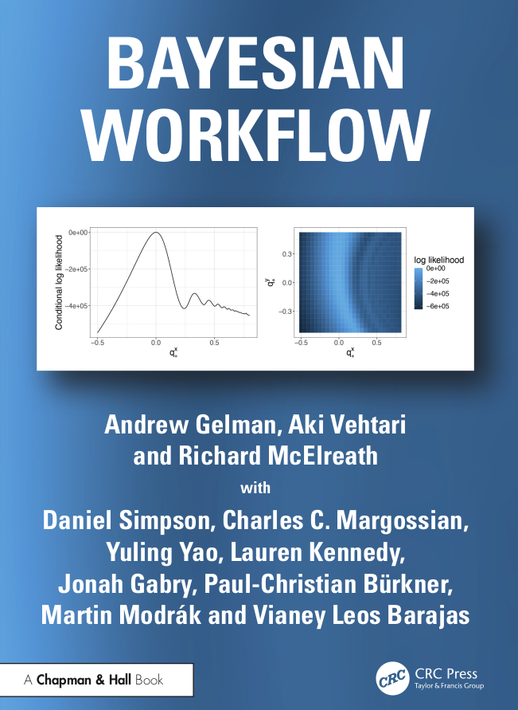
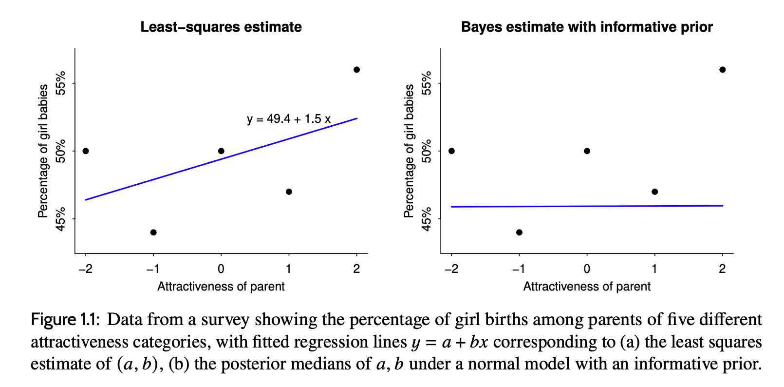

# Bayesian Workflow, chapter one

Book club is back! After a member saw a [podcast][] with the authors,
we started reading the [Bayesian Workflow][] book by Gelman, Vehtari,
and McElreath, which is freely available in PDF! (It seems McElreath,
of [Statistical Rethinking][], came on after the 2020 [paper][] that
was an early version of the book.) These are a few quotes and notes
from chapter one.

[podcast]: https://learnbayesstats.com/episode/bayesian-workflow-reverse-bayes-hierarchical-pooling-gelman-vehtari-mcelreath
[Bayesian Workflow]: https://avehtari.github.io/Bayesian-Workflow/
[Statistical Rethinking]: /20210508-statistical_rethinking_by_mcelreath/
[paper]: https://arxiv.org/abs/2011.01808

---

Structurally, the chapter falls like this:

 * Part 1: From Bayesian inference to Bayesian workflow
     * Chapter 1: Bayesian theory and Bayesian practice
         * 1.1 Why Bayes?
         * 1.2 Varieties of Bayesian theory
         * 1.3 There is no safe haven
         * 1.4 Convincing evidence
         * 1.5 Exercises

The chapter follows a brief “How to use this book” section. That has a
section called “Not a checklist, not a cookbook.”

The chapter itself is a neat little speed-run through Bayesian
inference, often quotable, with some philosophy and maybe a patina of
defensiveness from years of having to explain themselves to
“traditional” statistics.

There are indeed answers to “Why Bayes?” (scaling from simple to
complex models with latent parameters, integrating multiple sources of
information, using probability distributions that can be used for
decision analysis, stability from informative priors, and posterior
predictive checking) but that wasn't what most captured my attention.

---

> In theory, Bayesian data analysis provides features that are of
> practical importance for scientific research. In practice, Bayesian
> theory, like any statistical theory, is underspecified for coping
> with the many modular decisions involved in any real-world project.
> Our focus in this book is the practice of Bayesian data analysis, as
> supported by both statistical theory and transparent workflow. (page
> 3)

I feel like they couldn't resist this phrasing, in the style of the
old “in practice, the gap between theory and practice” joke. And then
the world-weary everything-is-tradeoffs theme starts from the first
paragraph.

---

> A sometimes annoying habit of Bayesians is to take non-Bayesian
> methods and give them Bayesian interpretations. For example,
> “maximum likelihood is just Bayesian inference with a flat prior,”
> “fixed effects are just random effects with the group-level variance
> set to infinity,” “lasso is just regression with an exponential
> prior,” or “confidence intervals are just posterior intervals
> assuming flat priors.” (page 6)

This is fun to have all collected hear, in good humor.

---

> As discussed in Chapter 1 of Bayesian Data Analysis, we do not see
> probability as having any unique foundation. Probability—and
> Bayesian inference, which is an application of probability—is a
> mathematical concept that applies to various problems, including
> long-run frequencies, betting, uncertainty, decision making, and
> statistical inference. In the real world, probability is not a
> perfect model for any of these scenarios: long-run frequencies are
> in practice not stationary, betting depends on your knowledge of the
> counterparty, uncertainty includes both known and unknown unknowns,
> decision making is open-ended, and statistical inference is
> conditional on assumptions that in practice will be false. That
> said, probability can be a useful tool for all these problems.
>
> Probability is a mathematical construct. To define it based on any
> imperfect real-world counterpart (such as betting or long-run
> frequency) makes about as much sense as defining a line in Euclidean
> space as the edge of a perfectly straight piece of metal, or as the
> space occupied by a very thin thread that is pulled taut.
> Ultimately, a line is a mathematical object that is analogized with
> different real-world phenomena. And probabilities are also
> mathematical objects that follow certain laws. Real-world models are
> important for the application of probability, and it makes sense
> that such an important concept is compatible with different
> real-world analogies, none of which is perfect. (page 8)

I don't think I had seen this before, in BDA or elsewhere, and it
might be the most interesting thing I'm taking from the chapter...

I have many times seen discussion of “this is frequentist probability,
this is Bayesian probability” etc. I'm in the middle of a book on many
worlds (Something Deeply Hidden) which spends a lot of time wringing
its hands about probability as well.

Maybe this is a good resolution? Probability as a mathematical
construct, rather than as defined in any particular way as a
real-world object?

(See also the next quote on subjective beliefs.)

---

> As in many aspects of life, an unrealistic but worthy goal can help
> us better align our assumptions, beliefs, rules, and actions. It
> used to be said that Bayesian probabilities represent the analyst’s
> subjective beliefs, but that just pushes the problem back one step,
> as it is not clear where a numerical expression of your subjective
> belief would come from, other than in idealized settings such as
> coin flips and rolls of a die. (page 9)

The first sentence is just a great quote in any setting.

But the bit about how “it used to be said”... I feel like I still hear
people saying this, though it does seem odd if you think about it too
carefully.

---

> The fundamental principle of decision theory is coherence. You can
> start with utilities and probabilities and deduce decision
> recommendations, or you can start with decisions and use these to
> infer implicit utilities and probabilities. More realistically, you
> can move back and forth: start with utilities and probabilities and
> deduce decision recommendations, then look at places where these
> recommendations conflict with your actual decisions or inclinations
> and explore your incoherence, ultimately leading to a change in
> assessed utilities and probabilities or a change in decision plans.
>
> That is, decision theory is two things. In the immediate sense, it’s
> a tool for allowing you to make decisions under uncertainty, in
> tangled settings where human intuition can fail. At the next level,
> it’s a tool for identifying incoherence—contradictions between our
> beliefs and actions that might not be immediately clear but are
> implicit if we work out their implications.
>
> In any setting where we make a series of decisions or statements, we
> can try to derive what we can of our implicit utilities, and from
> there find incoherence in our attitudes and behaviors.
>
> Finding incoherence is not the ultimate goal here—we’re animals, not
> machines, and we’ll be incoherent in all sorts of ways. Rather, the
> point in identifying incoherence is to be able to go back and find
> problems with our underlying assumptions. We are not trying to
> attain “a foolish consistency”; rather, checking for inconsistency
> is a tool that allows us to investigate our assumptions. (page 9)

I thought this was interesting because it just seems so cynical, at
first glance... I'm thinking mostly of corporate settings, where
leadership wants to justify some decision post hoc. But I think the
authors are sincere here, and really do see it as an iterative process
of discovery.

---

Here's a screenshot from page 11:

The implication is that the least-squares estimate is silly, and sure
enough there's a whole back-story:

[Kanazawa][] has published multiple papers, including a [2007 one][],
that all seem to make claims of extreme effects based on data that
isn't all that convincing. And Gelman (and others) have spent some
time trying to debunk this, as for example in [Of Beauty, Sex and
Power][]. Kanazawa seems to have bad takes in general.

[Kanazawa]: https://en.wikipedia.org/wiki/Satoshi_Kanazawa
[2007 one]: https://pubmed.ncbi.nlm.nih.gov/16949101/ "Beautiful parents have more daughters"
[Of Beauty, Sex and Power]: https://sites.stat.columbia.edu/gelman/research/published/power5r.pdf

---

> A procedure is not itself conservative or non-conservative; rather,
> conservatism is a property of what the method is being compared to.
> (page 12)

Sort of interesting and just another example of how the authors
consistently take a broader, “it depends” view of things everywhere.

---

From the questions at the end of the chapter:

> (j) Predictive model evaluation and averaging: considering several
> models fit to the same data, compare them using leave-one-out cross
> validation and use stacking to create a weighted average prediction
> model.

I wasn't sure at first what this all meant; I think now it really does
mean model stacking in the sense of making a “grand total” prediction
based on weighting the predictions from all the models, with the
weights chosen to optimize the LOO eval score. Seems like a good deal
of work, but maybe there's an R package called `loo` which can help,
if you want to do it?
