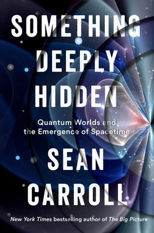

# (Audio) Something Deeply Hidden, by Carroll

In [Shape][], Ellenberg recommended [Something Deeply Hidden][] as “a
great nontechnical primer in the mathematics underlying quantum
physics,” but didn't mention that it's a many-worlds partisan
presentation. It's a lot like [What Is real?][] but with a very clear
answer offered up—and I'll grant it has some pretty good explanations.
I like [Carroll][] enough that I could see reading more from him. I
also think his belief in the many-worlds interpretation is
unsupportable.

[Something Deeply Hidden]: https://preposterousuniverse.com/somethingdeeplyhidden/
[Shape]: /20260917-shape_by_ellenberg/ "Shape, by Ellenberg"
[What Is real?]: /20250601-what_is_real_by_becker/ "What is real? by Becker"
[Carroll]: https://en.wikipedia.org/wiki/Sean_M._Carroll "Sean M. Carroll"

---

The title of the book, _Something Deeply Hidden,_ is taken from an
Einstein quote:

> A wonder of this kind I experienced as a child of four or five years
> when my father showed me a compass. That this needle behaved in such
> a determined way did not at all fit in the kind of occurrences that
> could find a place in the unconscious world of concepts (efficacy
> produced by direct “touch”). I can still remember—or at least
> believe I can remember—that this experience made a deep and lasting
> impression upon me.
>
> Something deeply hidden had to be behind things. (pages 281-282)

Magnets _are_ weird. Fields are weird. I think it's easy to forget how
wild the real world is. “The Force” in Star Wars is only weirder than
the magnetic force by degrees.

Carroll is saying that the thing that's deeply hidden is other
branches of the universal wave function—the “other worlds” of which
there are many.

The upcoming [Everything Is Fields][] has a title much more in line
with my recommendation to [Communicate Immediately][].

[Everything Is Fields]: https://www.quantabooks.org/books/everything-is-fields/
[Communicate Immediately]: /20200715-communicate_immediately/

Fields are weird.

---

As far as I can tell, Carroll really is serious about believing that
the quantum wave function is literally real.

I'm slowed down by just how bizarre this is, but I think his
presentation has helped me understand not just his but also other
people's beliefs which I hadn't properly understood before.

My old buddy [Kantor][] called it “Information Mechanics.” Carroll
quotes the famous [Wheeler][] “it from bit” but prefers “it from
qubit.” These folks seem to seriously believe that the stuff of the
universe, the real-real that-which-is, is information. For Carroll, it
is specifically the wave function. He believes a function _exists_!
Not just Plato-style, that a function exists in a realm of ideals, but
that the function exists _and is_ the universe. (Okay, maybe you could
argue it's not so different from the Plato style, as for example in
[Lockhart's explanation][], but I don't think it's a perfect fit
either.)

[Kantor]: /2012/05/18/quotes-from-frederick-w-kantor/ "Quotes from Frederick W. Kantor"
[Wheeler]: https://en.wikipedia.org/wiki/John_Archibald_Wheeler "John Archibald Wheeler"
[Lockhart's explanation]: /20261008-arithmetic_by_lockhart/ "Arithmetic, by Lockhart"

Carroll references the 1984 “[Particles do not exist][]” paper, and
I'm not trying to argue that particles exist as such. (I was reminded
of [Wilczek on quasiparticles][].) But surely believing that the wave
function is ontologically “real” is a huge map-is-the-territory error.

[Particles do not exist]: https://inis.iaea.org/records/cbaqj-q9w05
[Wilczek on quasiparticles]: /20240114-fundamentals_by_wilczek/ "Fundamentals: Ten Keys to Reality, by Wilczek"

Where I come out, I think, is with Meadows in [Thinking in Systems][]:
“Everything we think we know about the world is a model.” In
philosophy of science, it seems like this view is called Epistemic
Structural Realism, though perhaps people argue about the details. For
Kant, it seems like this view is called noumenal agnosticism. Going
back to the Greeks, maybe it's called [acatalepsy][].

[Thinking in Systems]: /20261008-thinking_in_systems_by_meadows/ "(Audio) Thinking in Systems, by Meadows"
[acatalepsy]: https://en.wikipedia.org/wiki/Acatalepsy

There is precedent for taking mathematical theories seriously. For
example, [Dirac][] had an equation that made it seem like there were
positrons, and then people observed positrons. But there are lots of
mathematical theories that make lots of untestable predictions, and I
don't feel at all compelled to believe that any of them are literally
real—not the predictions, not the theories.

[Dirac]: /20230816-strangest_man_by_farmelo/ "The Strangest Man, by Farmelo"

You don't need quantum theory to come up against the unknowability of
reality. The Greeks managed it. Point-like particles certainly don't
really make sense, for instance. Never mind the fallibility of the
senses; there's the infinite regress of perceiving things via senses
at all: you can't perceive a thing itself.

It certainly helps force a reckoning when you face a theory so deeply
different from intuitive physics as quantum theory is, though. To come
out of that by deciding that the theory itself, the mathematical
model, _is_ reality... I think this is silly.

Carroll seems good-natured enough about it though. He mentions that
many-worlds people are sometimes called “psi-ontologists” (psi, “Ψ,”
is the symbol for the wave function) and this is very funny. He
mentions that [QBists][] think many-worlds is “the reductio ad
absurdum of reifying the quantum state,” and I tend to agree.

[QBists]: https://en.wikipedia.org/wiki/QBism "QBism"

So while I really didn't think I'd come out of this liking the
Copenhagen interpretation, I think there's an interpretation of the
Copenhagen interpretation in which it's not just sloppy and stupid,
but noumenal-agnostic and strictly model-based. “Shut up and
calculate” because we acknowledge our limitations and know that we
can't truly know the nature of reality, but we can try to make
predictions about what we'll see.

Many of the various interpretations don't really come out seeming so
different:

 * Copenhagen: Observed macroscopic systems have particular states.
 * Many-worlds: Macroscopic systems decohere to particular states.
 * Spontaneous collapse: Macroscopic systems have so many particles
   that they're very likely to quickly settle particular states.

It's super annoying that Copenhagen talks about “observation” so much,
inviting weird consciousness discussions, but that might as well just
be a lack of clarity in exposition.

To bring up the cat: Even in Copenhagen, as I want to interpret it,
the cat is macroscopic and either alive or dead but never both.

Regardless: Maybe a never-collapsing wave function describes things
well, and maybe it doesn't, but I sure don't see a compelling reason
to believe that the wave function “is real.”

---

Decoherence. So much seems to hang on exactly what this is. I don't
think the book does a good job explaining it. Here's my best current
understanding:

If you have an electron that's half-up/half-down, you can express that
in a little local wave function. If you then do an up/down experiment,
you get a macroscopic system that's “half-up/half-down” and while you
could, it's silly to keep track of that in a big wave function: you
can treat the up side as practically separate from the down side now.
As two separate worlds.

How exactly this works mathematically, I'm not quite sure. I'm
especially unclear about continuous things, like position, or time to
decay.

I'm also not especially convinced that this resolves the observation
problem, in the sense that it seems like some external rule quietly
dictates that I find myself in exactly one “world” though there are
many... (Possibly this concern is related to the preferred basis
problem?)

---

I liked Carroll's treatment of Heisenberg uncertainty. He used spin
up/down versus left/right instead of (in addition to)
position/momentum. He said spin up can be expressed as equal parts
spin left/right, and that it's a choice of basis issue.

I want this to be a good explanation, but I have to admit I hadn't
thought of position/momentum as basis issues... they're operators,
right? Measurement changes the wavefunction? But then, I guess
measuring up/down changed the wavefunction (to be up, here) so maybe
it's not so different?

Maybe it is all basis issues, the same way uncertainty is sometimes
explained as position/momentum being Fourier transforms of one
another...

Yup, seems fine...

---

There's a good deal of fuss over probability. Carroll likes to call it
“self-locating uncertainty” because you just don't know which world
you're in. I think we might be better off with the “probability is a
mathematical concept” philosophy of [Gelman et al.][]

[Gelman et al.]: /20261023-bayesian_workflow_chapter_one/ "Bayesian Workflow, chapter one"

---

Part three of the book is about Carroll's attempts to get space (and
maybe time) out of quantum theory, using entanglement entropy. It
reminded me of [Wolfram Physics][] a little bit. There was also
entropic gravity and something about the holographic principle. It all
seemed a bit of a tease for unfinished theory.

[Wolfram Physics]: https://www.wolframphysics.org/

---

